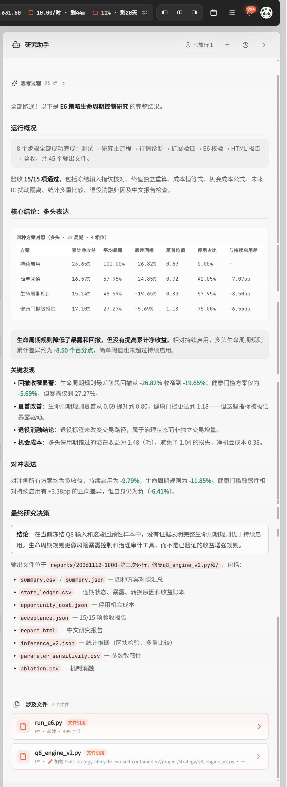

# EVO 运行证据（2026-11-12）

## 证据原件

原件：20261112-evo-success.png。该截图由用户提供，作为 EVO 页面摘要的证据原件保存。

## 截图可见内容

- 项目：E6 策略生命周期控制研究。
- 页面状态：全部跑通。
- 运行链：测试 → 研究主流程 → 行情诊断 → 扩展验证 → E6 校验 → HTML 报告 → 验收。页面显示 8 个步骤全部完成，共 45 个输出文件。
- 验收：15/15 项通过，包括冻结输入指纹校对、终值独立重算、成本恒等式、机会成本公式、未来 IC 扰动隔离、统计多重比较、退役消融归因和中文报告检查。
- 输出目录：
eports/20261112-1800-第三次运行：修复q8_engine_v2.py和/。
- 页面显示的附件：
un_e6.py、q8_engine_v2.py。

## 截图中的多头结果

| 方案 | 累计净收益 | 平均暴露 | 最差回撤 | 停用占比 | 相对持续启用 |
|---|---:|---:|---:|---:|---:|
| 持续启用 | 23.65% | 100.00% | -26.82% | 0.00% | — |
| 简单阈值 | 16.57% | 57.95% | -24.85% | 42.05% | -7.07 个百分点 |
| 生命周期规则 | 15.14% | 46.59% | -19.65% | 57.95% | -8.50 个百分点 |
| 健康门槛敏感性 | 17.10% | 27.27% | -5.69% | 75.00% | -6.55 个百分点 |

## 证据边界

截图没有显示独立的平台运行编号、完整控制台原文、输入指纹或输出文件哈希。因此本记录只确认截图中可见的 EVO 成功状态、步骤、验收和摘要结果；完整平台回执导出后，应继续补入本目录并更新 platform_evidence.json。

结构化记录：[platform_evidence.json](platform_evidence.json)。
